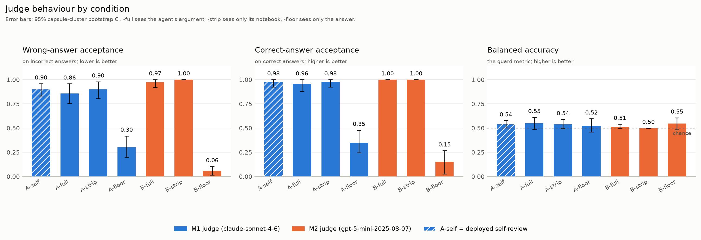

# bio-auditor

Does an AI agent judge its own scientific work more leniently than it judges the same work
attributed to someone else?

We ran a real bioinformatics agent on [BixBench](https://github.com/Future-House/BixBench), took
the answers it actually produced, and put each one to seven different reviewers that differ only
in **who judges**, **how much of the work they see**, and **whether the work is framed as their
own**.

## Findings

**The self-review hypothesis is not supported.** Reviewing its own prior turn, Claude Sonnet
accepted 63 of 70 wrong answers. Shown byte-identical content quoted as another agent's work, it
accepted 60 of 70.

| contrast | wrong-answer acceptance | 95% CI | p |
|---|---|---|---|
| `A-self` − `A-full` (the hypothesis) | +0.043 | [−0.059, +0.134] | 0.49 |
| `A-full` − `A-strip` (the prose argument) | −0.043 | [−0.123, +0.038] | 0.40 |
| `A-strip` − `A-floor` (**the notebook**) | **+0.600** | **[+0.475, +0.712]** | **<0.001** |

**What does matter is whether the judge sees the executed notebook at all**, and it makes them
credulous rather than discerning:

| judge sees | accepts wrong answers |
|---|---|
| the answer only | 30% (Sonnet), 6% (GPT-5 mini) |
| the answer + the notebook | 90% (Sonnet), 100% (GPT-5 mini) |

Balanced accuracy is 0.50–0.55 in **every** condition. Chance, everywhere. Handing a reviewer
checkable evidence shifts its threshold without adding any discrimination: it reads competent
looking code and endorses whatever number sits at the end of it.

One thing evidence did fix. In an earlier run where judges saw no data, self-review invented
ground truth in 43% of its rejections. Here, every asserted counter-value appears in the notebook,
100% of the time across all conditions.

**Caveat, stated up front:** `B-strip` (GPT-5 mini, notebook, no prose) accepted all 116 answers
without exception. Its 1.000 is a blanket verdict, not a measurement. `B-full` at 0.97 is nearly
as degenerate. The analysis flags both automatically.



## Design

`N` = the executed notebook. `P` = the agent's own prose turns. `V` = the answer it submitted.

| id | judge | sees | the work is tagged as |
|---|---|---|---|
| `A-self` | Sonnet | N + P + V | `assistant` — its own prior turn |
| `A-full` | Sonnet | N + P + V | `user` — quoted from another agent |
| `A-strip` | Sonnet | N + V | `user` — quoted |
| `A-floor` | Sonnet | V only | `user` — quoted |
| `B-full` | GPT-5 mini | N + P + V | `user` — quoted |
| `B-strip` | GPT-5 mini | N + V | `user` — quoted |
| `B-floor` | GPT-5 mini | V only | `user` — quoted |

The review instruction is one fixed string, sha-checked at import, framed as a gate rather than a
quiz (ACCEPT/REJECT, a confidence integer, one sentence). It never varies by condition — a gap
traceable to prompt wording would make the whole grid uninterpretable.

`-strip` is not a separately rendered prompt. Both payloads come from one block list through one
function, and `-strip` is that function with the prose blocks filtered out. Before any API call,
six assertions run over every row and fail loudly: the two `-full` payloads byte-identical, the
two `-strip` byte-identical, the two `-floor` byte-identical, `-strip` equal to `-full` minus
exactly the prose, `A-self`'s assistant turn equal to the `-full` work plus the answer, and the
instruction terminal and identical in all seven.

Ground truth is deterministic. We use only BixBench's 122 `str_verifier` and `range_verifier`
questions, so no model assigns a correctness label. Where an answer's prose contained several
numbers, a human (and, for the bulk, an extractor with no sight of the target) chose which value
the agent was claiming; code then graded it. `src/grade_truth.py` carries the comparator, the
unit-conversion rule and the one documented human override; `results/adjudications.csv` is what the
adjudicator saw and chose.

## Layout

```
src/            the pipeline
  render.py     N and P rendering; the single code path -strip depends on
  collect.py    trajectories -> results/answers.csv
  grade_truth.py deterministic labelling + blind adjudication flow
  judge.py      the seven conditions, with the assertions
  analyze.py    metrics, contrasts, figures
  v1_archive/   an earlier null run, kept for provenance
harness/        our additions to BixBench (see harness/README.md)
data/           the stage-1 output, gzipped. This is the expensive artefact (~$105)
results/        summary.md and every CSV the analysis reads; v1/ is the earlier null run
paper/          figures
logs/           run logs
```

## Reproducing

Stages 2–4 need no agent run: unpack `data/` and go.

```bash
python -m venv .venv && .venv/bin/pip install -r requirements.txt
mkdir -p ~/bixbench/data/trajectories/bioauditor-s1
tar xzf data/trajectories_json.tgz  -C ~/bixbench/data/trajectories/bioauditor-s1
tar xzf data/trajectories_jsonl.tgz -C ~/bixbench/data/trajectories/bioauditor-s1

.venv/bin/python src/collect.py          # -> results/answers.csv
.venv/bin/python src/grade_truth.py      # -> results/labelled.csv
.venv/bin/python src/judge.py --assert-only   # verifies the invariants, spends nothing
.venv/bin/python src/judge.py            # ~$9, 812 calls
.venv/bin/python src/analyze.py          # -> summary.md, figures
```

Regenerating stage 1 from scratch costs about $95 and four hours. See `harness/README.md`.

## Cost

| stage | spend |
|---|---|
| stage 1, agent runs | ~$95 |
| stage 3, judging | $9.39 |
| an earlier null run (v1) | $12.34 |

## Models

- `claude-sonnet-4-6` — the stage-1 agent, and the judge in every `A-*` condition. It must be the
  same model in both roles or `A-self` is not self-review.
- `gpt-5-mini-2025-08-07` — judge only. A different family, so "another agent's work" is true.
